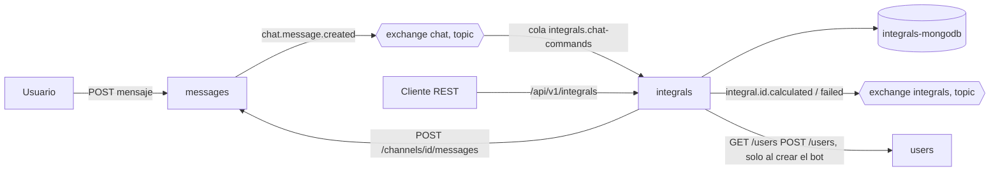

# Servicio `integrals`

Calcula integrales a partir de texto LaTeX. Se usa por REST y desde el chat con `/integralcalc <latex>`.
No modifica `users`, `channels` ni `messages`.

## 1. Lenguaje ubicuo

| Término | Significado |
| --- | --- |
| Integral | Cálculo solicitado: un texto LaTeX y su resultado. Es la raíz de la agregación. |
| Solicitud | Origen del cálculo: `rest` o `chat` (con el mensaje que lo disparó). |
| Resultado | Expresión simbólica en LaTeX y, si aplica, su valor numérico. |
| Estado | `calculated` o `failed`. Una vez fijado no cambia (invariante). |
| Comando | Mensaje de chat que empieza con `/integralcalc` o `/integral`. |
| Bot | Usuario `integralbot` que responde en el canal. |

Invariantes de `Integral`: tiene un `latex` no vacío de hasta 1 000 caracteres; tiene `result` si y solo si `status = calculated`; tiene `error` si y solo si `status = failed`; un mismo mensaje de chat genera como máximo una integral. Para garantizarlo, el `id` de una integral de chat es determinista (`uuid5` del `message_id`) y se usa como `_id` de Mongo.

## 2. Contexto acotado y servicios

Un solo servicio de negocio: `integrals`. Su razón de cambio es "cómo se calculan y registran integrales".

El adaptador de chat (consumidor de eventos + cliente de `messages`) vive dentro de `integrals` como módulo separado. 

Infraestructura nueva en el compose: `rabbitmq` e `integrals-mongodb`.

Datos: `integrals-mongodb` es de uso exclusivo de `integrals`.
- `integrals`: una `Integral` por documento.
- `bot_identity`: guarda el `user_id` del bot.

`integrals` referencia a otros contextos solo por ID: `channel_id`, `author_id`, `message_id`. Nunca copia sus objetos.

## 3. Diagrama



## 4. Puntos de comunicación: estilo ⇝ patrón ⇝ tecnología

| # | Punto | ¿Cómo se comunican? | Justificación |
| --- | --- | --- | --- |
| 1 | Cliente → `integrals` | Request-response sincrónico ⇝ REST (OpenAPI) | Interfaz explícita y simple para los consumidores. El cálculo tiene tope de 10 s. |
| 2 | `messages` → `integrals` | Event-driven ⇝ pub/sub ⇝ RabbitMQ | `messages` no sabe que `integrals` existe. Se consume `chat.message.created` tal como se publica hoy. |
| 3 | `integrals` → `messages` (respuesta del bot) | Request-response sincrónico ⇝ REST | Usa la API pública existente. Se evita escribir en la base de otro servicio. |
| 4 | `integrals` → mundo | Event-driven ⇝ pub/sub ⇝ RabbitMQ | Un evento por cada transacción, con toda la información (auditable, sin consulta de vuelta). |
| 5 | `integrals` → `users` | Request-response sincrónico ⇝ REST | Solo para crear el bot una vez. |

Acoplamiento: de dominio con `messages` y `users`. 

## 5. Contrato REST (`/api/v1`, OpenAPI en `/docs`)

| Método y ruta | Descripción | Respuestas |
| --- | --- | --- |
| `POST /api/v1/integrals` | Calcula una integral. Cuerpo: `{"latex": "..."}` | 201 `Integral`; 422 entrada inválida |
| `GET /api/v1/integrals/{id}` | Consulta una integral | 200; 404 |
| `GET /api/v1/integrals?limit=&offset=&status=` | Historial paginado | 200 |
| `GET /health` | Estado del servicio | 200 |

Esquema `Integral`:

```json
{
  "id": "uuid",
  "latex": "\\int_0^1 x^2 \\, dx",
  "status": "calculated | failed",
  "result": {"latex": "\\frac{1}{3}", "numeric": 0.3333333333, "indefinite": false},
  "error": {"code": "LATEX_INVALID", "message": "..."},
  "source": {"kind": "rest | chat", "channel_id": null, "author_id": null, "message_id": null},
  "duration_ms": 12,
  "created_at": "ISO-8601 UTC"
}
```

Códigos de error del cálculo (campo `error.code`):
- `LATEX_INVALID`: el texto no se puede interpretar.
- `NOT_AN_INTEGRAL`: el LaTeX es válido pero no contiene `\int`.
- `UNSOLVABLE`: SymPy devolvió la integral sin evaluar.
- `TIMEOUT`: superó el límite de tiempo (10 s).

Formato de error HTTP: `{"code": "...", "message": "..."}`. La validación de forma devuelve 422.

IMPORTANTE: un cálculo que no se pudo resolver no es un error HTTP. Se registra como `Integral` con `status = failed` y se responde 201. La solicitud fue procesada y el fallo es un resultado de factible.

## 6. Eventos

Exchange `integrals`, tipo `topic`. Routing key `integral.<id>.<acción>`.

| Routing key | Cuándo | Payload |
| --- | --- | --- |
| `integral.<id>.calculated` | Cálculo exitoso | `Integral` completa |
| `integral.<id>.failed` | Cálculo fallido | `Integral` completa |

Eventos consumidos: exchange `chat`, routing key `chat.message.created`, cola durable `integrals.chat-commands`.
- Payload esperado en `data`: `id`, `channel_id`, `author_id`, `content`, `created_at`.
- `messages` declara el exchange `chat` como `topic`. `integrals` debe declararlo con los mismos parámetros, o RabbitMQ rechaza la declaración.

## 7. Flujo del comando de chat

1. Un mensaje llega por `chat.message.created`.
2. Se descarta si `author_id` es el del bot (evita bucles) o si `content` no empieza con `/integralcalc` o `/integral`.
3. Se calcula el `id`. Si ya existe una integral con ese `id`, el mensaje es un duplicado y se descarta (RabbitMQ entrega al menos una vez).
4. Se parsea y se calcula en un proceso aparte con tope de 10 s.
5. Se guarda el resultado y se publica `integral.<id>.calculated` o `.failed`.
6. Se responde en el canal con `POST /channels/{channel_id}/messages` como el bot. Hasta 3 reintentos con espera creciente. Si fallan todos, se registra el error y el evento ya emitido se mantiene.
7. Se hace `ack` del mensaje al terminar el paso 5.

Consecuencia: El cálculo y la respuesta en el chat no son una sola transacción. No se usa saga. Si la respuesta falla, el resultado sigue consultable por REST. 

## 8. Bot

`users` solo permite `POST` y `GET /{id}`: no se puede buscar por nombre. Por eso `integrals` guarda en su propia colección `bot_identity` el `user_id` y lo crea una sola vez al inicializar (`display_name = "integralbot"`). Si la base ya lo tiene, no vuelve a crearlo.

## 9. Cálculo

- Parser: `sympy.parsing.latex.parse_latex`.
- Prueba previa (SymPy 1.14.0, `antlr` y `lark`): `\int x^2 dx`, `\int_0^1 x^2 \, dx`, `\int_0^\infty e^{-x} dx`, `\int \sin(x) dx`, integral doble anidada y `\int \frac{1}{x} dx` se interpretan bien.
- Detalle posterior: `parse_latex` lee `e` y `\pi` como símbolos cualquiera. `calculator.py` los reemplaza por las constantes `E` y `pi`, salvo que sean la variable de integración.
- Las pruebas cubren integrales indefinidas, definidas, impropias y múltiples, entradas malformadas, integrales sin solución en SymPy y el timeout.
- Nunca se usa `eval` ni `sympify` sobre el texto del usuario.
- El cálculo corre en un proceso hijo que se termina al superar el tiempo límite.

## 10. Trazabilidad

- Logs JSON a stdout con `correlation_id`.
- En REST: header `X-Correlation-ID` (se genera si falta y se devuelve).
- En el flujo de chat: el ID del mensaje original es el `correlation_id`, y viaja en el evento emitido y en la llamada a `messages`.

Es netamente para tener una trazabilidad/logs por interacción.

## 11. Cambios mínimos al compose

- Agregar `rabbitmq` (con healthcheck), `integrals` e `integrals-mongodb`.
- Agregar `RABBITMQ_URL` a `messages` y `depends_on: rabbitmq (healthy)`. Es configuración. Sin esto `messages` no publica, y como ignora los fallos de publicación, los primeros eventos se perderían en silencio.
- `integrals` no usa `--reload` en su Dockerfile.

